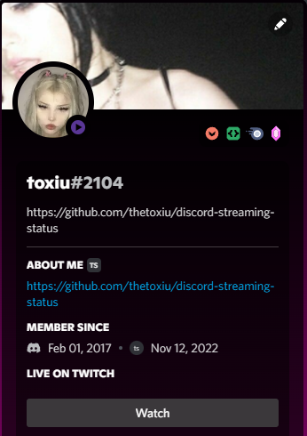
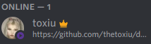

# Discord Streaming Status

Sets the purple **Streaming** status on your own Discord account.

<br>


> ⚠️ This is a selfbot (it logs in with your user token). Automating user accounts
> is against Discord's Terms of Service and can get your account disabled. Use at your own risk.

## Requirements

- Python **3.10+**
- [discord.py-self](https://github.com/dolfies/discord.py-self) — the regular `discord.py`
  no longer supports user tokens. Both install as `discord`, so remove the old one first:

```bash
pip uninstall -y discord.py discord
```

```bash
pip install -r requirements.txt
```

## Usage

1. Copy `config.example.json` to `config.json` and fill it in:

   | key      | meaning                                                         |
   |----------|-----------------------------------------------------------------|
   | `token`  | your user token                                                 |
   | `name`   | text shown after "Streaming"                                    |
   | `url`    | must be a `twitch.tv` or `youtube.com` link, or the status won't be purple |
   | `status` | `online`, `idle`, `dnd` or `invisible`                          |

   Instead of putting the token in the file you can set the `DISCORD_TOKEN` environment variable.
   `config.json` is in `.gitignore`, so your token won't be committed.

2. Run it:

```bash
python main.py
```

Keep it running — the status disappears when the script stops.
